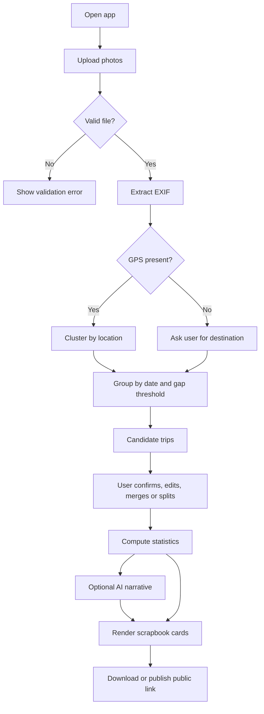
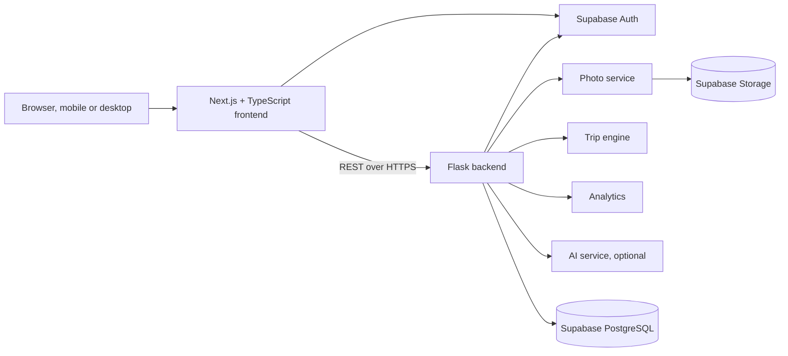
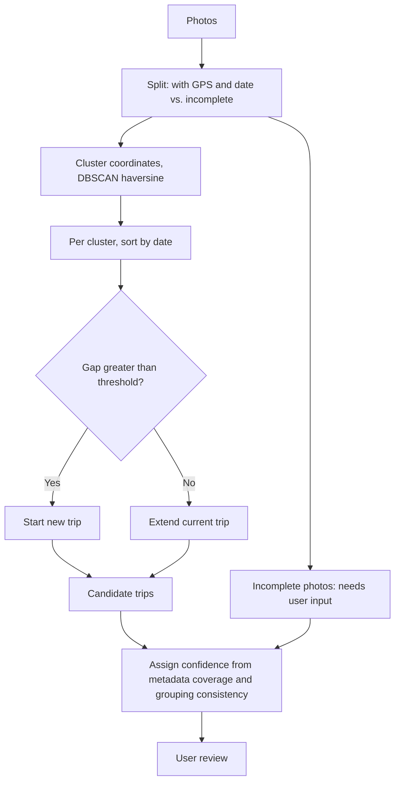
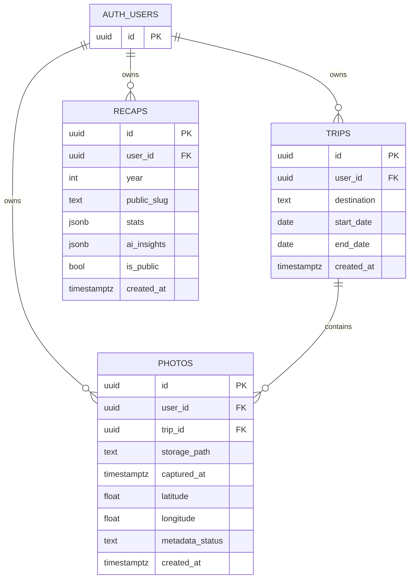

# TravelWrapped

**Your year. Your journeys. Your stories.**

TravelWrapped is a mobile-first travel memory and storytelling application. Users upload travel photographs; the application reads available EXIF metadata (timestamps, GPS), proposes candidate trips using deterministic geospatial and temporal rules, computes travel statistics, and renders a scrapbook-style annual recap that can be downloaded and shared.

> **Project status: design / kickoff stage.** This README was written from the product requirements document and architecture plan, before any application code existed. Every feature below is marked **Planned** unless stated otherwise. Statuses must be updated as milestones are completed. No deployment, test results, metrics or screenshots exist yet.

Built by Ragini Roy for the goSTOPS Build Sprint. Not an official goSTOPS product.

| | |
|---|---|
| Live demo | _Not deployed yet_ |
| Repository | _Add URL when created_ (`travel-wrapped`) |
| License | _Not yet specified_ |

**Intended stack** (not yet verified against code): Next.js, React, TypeScript, Tailwind CSS, Python, Flask, Pydantic, Supabase (PostgreSQL, Auth, Storage), Pillow, geopy, scikit-learn, Leaflet, Pytest, ESLint, Vercel, Render.

---

## Table of contents

1. [Overview](#overview)
2. [Feature status](#feature-status)
3. [Application workflow](#application-workflow)
4. [System architecture](#system-architecture)
5. [Repository structure](#repository-structure)
6. [Technical design](#technical-design)
7. [Trip detection algorithm](#trip-detection-algorithm)
8. [Database design](#database-design)
9. [API design](#api-design)
10. [AI integration](#ai-integration)
11. [Local development](#local-development)
12. [Environment variables](#environment-variables)
13. [Testing and quality](#testing-and-quality)
14. [Security and privacy](#security-and-privacy)
15. [Deployment](#deployment)
16. [Known limitations and roadmap](#known-limitations-and-roadmap)
17. [Contributing](#contributing)
18. [License and acknowledgements](#license-and-acknowledgements)

---

## Overview

**Problem.** People take hundreds of photographs while travelling, but the memories stay scattered across a phone and rarely become a coherent story.

**Solution.** TravelWrapped turns a batch of photos into a travel-year scrapbook: detected trips, destinations, statistics, a timeline, personalised insights, shareable story cards and an optional public recap page.

**Audience.** Gen Z travellers, solo and weekend travellers, students and young professionals who enjoy sharing travel content.

**How it works.** Photos are validated and parsed for EXIF data. Photos with GPS are clustered by location and grouped by date into candidate trips. The user confirms or corrects them. Statistics are computed deterministically, then rendered into scrapbook-style cards.

**Differentiator.** The user never needs to understand metadata, maps or AI. Trip detection and statistics are rule-based and testable; AI is an optional layer for wording only.

**Design principle.** Business logic lives in the backend, not in React components, so it can be tested independently. The AI never decides whether someone visited a place and never produces statistics.

## Feature status

Status values: **Implemented**, **Partial**, **Planned**. Everything is currently **Planned**.

| Area | Capability | Priority | Status |
|---|---|---|---|
| Photo ingestion | Multi-file upload (JPG, JPEG, PNG, WebP), type and size validation, previews, upload progress | P0 | Planned |
| Photo ingestion | 30 images per session limit, configurable max file size | P0 | Planned |
| EXIF extraction | Capture timestamp and GPS extraction, handling of missing metadata | P0 | Planned |
| Trip detection | GPS clustering plus date grouping, trip boundary detection | P0 | Planned |
| Manual correction | Edit destination and dates, merge and split trips, manual destination for photos without GPS | P0 | Planned |
| Analytics | Photo and trip totals, unique destinations, top destination, longest trip, busiest month, timeline | P0 | Planned |
| Analytics | Estimated distance (only if the data supports a defensible calculation) | P1 | Planned |
| Recap generation | Cover, year overview, destination collage, trip highlights, stats, closing page | P0 | Planned |
| Maps | Interactive Leaflet map of trips | P1 | Planned |
| AI narratives | Travel personality, year-end narrative, captions, trip titles | P1 | Planned |
| Theming | Scrapbook theme customisation, regenerate after edits | P1 | Planned |
| Story cards | Download individual cards and full recap | P0 | Planned |
| Public sharing | Unique public URL, copy link, preview, public/private toggle, social preview metadata | P0 | Planned |

## Application workflow

1. User opens the application.
2. User uploads travel photographs.
3. Files are validated (type, size, count).
4. Available EXIF metadata is extracted.
5. Date and location information is processed.
6. Candidate trips are identified.
7. User reviews and corrects trips.
8. Statistics are generated.
9. Scrapbook layouts are created.
10. User downloads or shares the recap.



## System architecture



| Component | Responsibility |
|---|---|
| Next.js | UI, client-side validation, story renderer, export |
| Flask | Validation, EXIF extraction, trip detection, analytics, recap generation, AI orchestration |
| Supabase Auth | Identity (anonymous session first, optional accounts later) |
| PostgreSQL | Users' trips, photos, recaps, with RLS |
| Supabase Storage | Private originals, thumbnails, generated assets |
| AI provider | Optional narrative text only |

**Why separate layers.** Presentation changes often; processing logic must stay deterministic and unit-testable; data and file storage need their own access control. Keeping trip detection out of React also lets the Python geospatial stack (Pillow, geopy, scikit-learn) do the heavy work.

**Public sharing.** A public page reads only the approved `recaps` row (stats, insights, selected card assets) via the slug. It never queries the `photos` table or original files.

## Repository structure

The intended structure is below. Because the frontend is planned with `create-next-app` using the `src/` option, the app directory is `frontend/src/app`. **None of this has been verified against a real working tree**; regenerate this section from the actual repository.

```text
travel-wrapped/
├── frontend/
│   ├── src/
│   │   ├── app/            # routes: page.tsx, upload/, trips/, wrapped/, share/
│   │   ├── components/     # scrapbook/, upload/, trips/, ui/
│   │   ├── lib/            # API client, helpers
│   │   └── types/          # shared TypeScript types
│   └── package.json
├── backend/
│   ├── app/
│   │   ├── routes/         # HTTP layer
│   │   ├── services/       # photo, trip engine, analytics, AI
│   │   ├── models/         # Pydantic models
│   │   ├── utils/
│   │   └── config/
│   ├── tests/
│   ├── requirements.txt
│   └── run.py
├── docs/                   # PRD.md, ARCHITECTURE.md, API.md (planned)
├── .gitignore
└── README.md
```

## Technical design

All items below are **planned design**, not implemented behaviour.

1. **Upload and validation.** Accept JPG, JPEG, PNG, WebP; max 30 images per session; configurable max file size. Validate on the client for fast feedback and again on the server for trust. Detect duplicates (approach to be decided, for example content hash).
2. **EXIF extraction.** Pillow EXIF support or `exifread` (final choice pending) for capture time and GPS. GPS rational values are converted to decimal degrees.
3. **Missing or inaccurate metadata.** Each photo carries a `metadata_status`. Photos without GPS are never silently assigned a location; the user supplies a destination. Missing dates are surfaced for manual entry.
4. **Geographic clustering.** DBSCAN with a haversine metric (if it proves useful), with configurable radius.
5. **Temporal grouping.** Configurable maximum day gap between photos in the same trip.
6. **Destination resolution.** Reverse geocoding of cluster centroids, always presented as a suggestion the user can edit.
7. **Statistics.** Pure functions over confirmed trips and photos. Distance is only computed when the data supports it.
8. **Recap generation.** Statistics are persisted in `recaps.stats` (JSONB). Regeneration must be idempotent (no duplicate recap rows for the same user and year).
9. **AI narrative.** See [AI integration](#ai-integration).
10. **Story cards.** Vertical Instagram-friendly layouts rendered in React and exported to images client-side (HTML-to-image library to be chosen). Must be tested on a real Android phone.

**Visual direction.** Warm cream paper background, coral primary accent, lavender secondary, butter-yellow highlights, playful display font with a readable sans-serif, tape, stamps, doodles and Polaroid-style frames.

## Trip detection algorithm

**Input.** Photo records with `captured_at`, `latitude`, `longitude` (any may be null).

**Pipeline (design).**



```text
function detect_trips(photos, radius_km, max_gap_days):
    located = [p for p in photos if p.lat and p.lon and p.captured_at]
    unplaced = the rest
    clusters = dbscan(located, eps=radius_km, metric=haversine)
    trips = []
    for cluster in clusters:
        sort cluster by captured_at
        current = [first photo]
        for photo in rest:
            if days_between(current.last, photo) > max_gap_days:
                trips.append(current); current = [photo]
            else:
                current.append(photo)
        trips.append(current)
    return trips with confidence, plus unplaced photos flagged for the user
```

**Thresholds.** `radius_km` and `max_gap_days` are configurable; defaults are to be chosen from testing. A fixed 30-day gap is not necessarily a new trip, and a fixed radius is not necessarily one destination, which is why users can correct results.

**Confidence.** Computed from metadata coverage and grouping consistency, never from an LLM.

**Edge cases to handle:** photos without GPS; missing dates; multiple destinations in one journey; wrong device timestamps; duplicates; photos spanning multiple years; low-precision GPS.

**Limitations.** Automatic grouping is heuristic. It cannot know intent (a commute versus a trip), may split or merge incorrectly, and depends on metadata that many apps strip.

## Database design

**Status: proposed schema (design only; no migrations exist).** User identity comes from Supabase Auth.



```sql
CREATE TABLE trips (
    id UUID PRIMARY KEY DEFAULT gen_random_uuid(),
    user_id UUID NOT NULL REFERENCES auth.users(id),
    destination TEXT,
    start_date DATE,
    end_date DATE,
    created_at TIMESTAMPTZ DEFAULT NOW()
);

CREATE TABLE photos (
    id UUID PRIMARY KEY DEFAULT gen_random_uuid(),
    user_id UUID NOT NULL REFERENCES auth.users(id),
    trip_id UUID REFERENCES trips(id),
    storage_path TEXT NOT NULL,
    captured_at TIMESTAMPTZ,
    latitude DOUBLE PRECISION,
    longitude DOUBLE PRECISION,
    metadata_status TEXT DEFAULT 'pending',
    created_at TIMESTAMPTZ DEFAULT NOW()
);

CREATE TABLE recaps (
    id UUID PRIMARY KEY DEFAULT gen_random_uuid(),
    user_id UUID NOT NULL REFERENCES auth.users(id),
    year INTEGER NOT NULL,
    public_slug TEXT UNIQUE,
    stats JSONB NOT NULL DEFAULT '{}',
    ai_insights JSONB DEFAULT '[]',
    is_public BOOLEAN DEFAULT FALSE,
    created_at TIMESTAMPTZ DEFAULT NOW()
);

CREATE INDEX photos_user_id_idx ON photos(user_id);
CREATE INDEX trips_user_id_idx ON trips(user_id);
CREATE INDEX recaps_public_slug_idx ON recaps(public_slug);
```

| Table | Purpose | Notes |
|---|---|---|
| `trips` | A detected or user-edited journey | Owned by one user |
| `photos` | Photo record, storage path and extracted metadata | Optional `trip_id`; never publicly readable |
| `recaps` | One per user and year; stats, insights, publish state | Public access only via slug when `is_public` is true |

**Open schema items:** a unique constraint on `(user_id, year)` for idempotent regeneration is recommended; RLS policies are not yet written (every user-owned table needs owner-only policies; public recap access must expose only approved recap data, never `photos`); processing-job tables and normalised trip-photo relations are deferred.

## API design

**Status: all endpoints Planned.** Request and response schemas are not finalised.

| Method | Endpoint | Description |
|---|---|---|
| GET | `/api/v1/health` | Health check (first milestone) |
| POST | `/api/v1/photos/upload` | Register uploaded photos |
| POST | `/api/v1/photos/analyze` | Extract metadata |
| POST | `/api/v1/trips/detect` | Detect candidate trips |
| PATCH | `/api/v1/trips/:id` | Edit a trip |
| POST | `/api/v1/trips/:id/merge` | Merge trips |
| GET | `/api/v1/recaps/:year` | Retrieve recap |
| POST | `/api/v1/recaps/:year/generate` | Generate recap |
| POST | `/api/v1/recaps/:id/publish` | Publish recap |
| GET | `/api/v1/public/:slug` | Retrieve public recap (no auth) |

All endpoints except the health check and public recap are intended to require a Supabase-issued identity. Standard responses use a `status` / `data` envelope.

Illustrative (not implemented) response for `POST /api/v1/trips/detect`:

```json
{
  "status": "success",
  "data": {
    "detected_trips": 2,
    "trips": [
      { "destination": "Jaipur", "photo_count": 12, "confidence": "high", "needs_confirmation": false },
      { "destination": null, "photo_count": 8, "confidence": "low", "needs_confirmation": true }
    ]
  }
}
```

## AI integration

**Status: Planned, optional (P1).**

- **Why.** Personality, narrative and caption wording. Not trip detection, not statistics.
- **Input.** Only verified statistics and user-approved destinations, as structured JSON.
- **Flow.** Verified stats -> structured JSON -> LLM prompt -> generated text -> output validation (Pydantic schema) -> renderer.
- **Hallucination control.** The model receives no free-form data and must not introduce locations, durations or activities; output is validated against the supplied facts.
- **Deterministic numbers.** Every figure shown on a card comes from backend computation, never from model output.
- **Personality labels.** Candidates (Mountain Soul, Weekend Wanderer, City Explorer, Spontaneous Traveller, Memory Collector) are chosen from trip data; the user can change the displayed label.
- **Fallback.** A deterministic non-AI text template is used if the AI is disabled, fails or is rejected by validation.
- **Cost.** Generate once per recap and cache in `recaps.ai_insights`.
- **Provider.** Not yet selected.

## Local development

These commands come from the project plan and have **not** been run against a real repository.

**Prerequisites:** Node.js and npm, Python 3 (Windows `py` launcher), Git, and a Supabase account.

Verify tools (PowerShell):

```powershell
node --version
npm --version
py --version
git --version
```

Create the project:

```powershell
mkdir travel-wrapped
cd travel-wrapped
npx create-next-app@latest frontend
# Choose: TypeScript Yes, ESLint Yes, Tailwind Yes, App Router Yes, src/ directory Yes, alias @/*

mkdir backend
cd backend
py -m venv venv
.\venv\Scripts\Activate.ps1
py -m pip install flask flask-cors python-dotenv pillow supabase pydantic pytest
```

For an existing clone:

```powershell
git clone <REPOSITORY_URL>
cd travel-wrapped

# Frontend
cd frontend
npm install

# Backend
cd ../backend
py -m venv venv
.\venv\Scripts\Activate.ps1
py -m pip install -r requirements.txt
```

Run frontend and backend in **separate terminals**. Exact start commands are pending until the code exists; expected defaults are `npm run dev` in `frontend` and `py run.py` in `backend`. Specialised dependencies (EXIF, geopy, scikit-learn) will be added after the base setup works.

**First engineering deliverable:** landing page running locally, Flask running with `/api/v1/health`, Next.js successfully calling it, and an initial commit.

## Environment variables

Proposed, not yet verified against code. Never commit real values; commit only `.env.example` files.

**Frontend** (`frontend/.env.local`; `NEXT_PUBLIC_` values are visible in the browser):

```dotenv
NEXT_PUBLIC_SUPABASE_URL=
NEXT_PUBLIC_SUPABASE_ANON_KEY=
NEXT_PUBLIC_API_URL=http://localhost:5000
```

**Backend** (`backend/.env`; server-side secrets only):

```dotenv
SUPABASE_URL=
SUPABASE_SERVICE_ROLE_KEY=   # secret: bypasses RLS, never expose to the browser
AI_PROVIDER_API_KEY=         # only if AI features are enabled
FLASK_ENV=development
```

The Flask port and the real variable set must be confirmed once the backend exists.

## Testing and quality

Nothing has been executed yet, so no results are reported. Planned coverage:

- Unit tests (Pytest) for EXIF parsing, GPS conversion, clustering, date grouping, statistics.
- API tests for each Flask route and validation error.
- Integration tests for the upload -> detect -> recap flow.
- Frontend: ESLint and client-side validation checks.
- Manual: a full journey on a real Android phone, mobile responsiveness.

Planned scenarios: 20-photo upload; unsupported file; photo with no GPS; duplicate photo; same destination across dates; destination edit updates stats; generating a recap twice creates no duplicates; private recap URL denied; public recap shows only approved data; image export works on Android.

Commands (to be confirmed):

```powershell
cd backend
.\venv\Scripts\Activate.ps1
py -m pytest

cd ../frontend
npm run lint
```

## Security and privacy

Planned measures (none verified yet):

- **Auth and authorisation.** Supabase Auth identity; owner-only RLS on `trips`, `photos`, `recaps`.
- **Storage.** Private buckets; signed URLs for owner access.
- **Uploads.** Type, size and count validation on server; abuse prevention and rate limiting to be designed.
- **GPS privacy.** Public recaps contain only approved aggregate data (destination names, stats, rendered cards), never precise coordinates or original files. Consider stripping EXIF from derived images.
- **Public access.** Controlled by `is_public`; unpublished slugs return no data.
- **Secrets.** Service-role and AI keys live only in backend environment variables.
- **Deletion.** A user data deletion path (records and stored files) is planned.

## Deployment

**Status: not deployed.** Intended targets: Vercel (frontend), Render (backend), Supabase (managed). Still to document once they exist: build and start commands, production environment variables, CORS allow-list for the frontend origin, Supabase bucket and RLS configuration, and the health-check URL (`/api/v1/health`).

## Known limitations and roadmap

**Expected limitations**

- Missing or stripped EXIF metadata.
- Incorrect device timestamps.
- Imperfect destination detection and reverse geocoding.
- Limited route reconstruction.
- AI narratives are limited to wording supplied statistics.

**Roadmap (from the plan)**

| Milestone | Scope |
|---|---|
| 1. Foundation | Repo, Next.js, Flask, env config, Supabase project, frontend-to-backend health check |
| 2. Photo processing | Validation, private storage, EXIF, photo records, missing-metadata handling |
| 3. Trip intelligence | Clustering, date grouping, destination resolution, trip editor |
| 4. Generator | Statistics, scrapbook layouts, collages, image export, recap pages |
| 5. AI and sharing | Personality, captions, public URLs, social previews, privacy controls |
| 6. Launch | Deploy, mobile testing, real users, analytics, bug fixes |

**Success metrics (to be measured and reported honestly):** activation rate (recaps generated / unique visitors), upload completion rate, share rate, organic referrals from shared links.

## Contributing

1. Fork the repository and create a branch (for example `feature/trip-detection`).
2. Use clear commit messages; Conventional Commits (`feat:`, `fix:`, `docs:`) are recommended.
3. Add or update tests for backend logic changes.
4. Run linting and tests before opening a pull request.
5. Open a pull request describing the change and how it was tested.

Keep business logic in the backend, keep AI out of any factual computation, and do not commit secrets.

## License and acknowledgements

No license has been specified yet.

Built by Ragini Roy for the goSTOPS Build Sprint. Not an official goSTOPS product.
